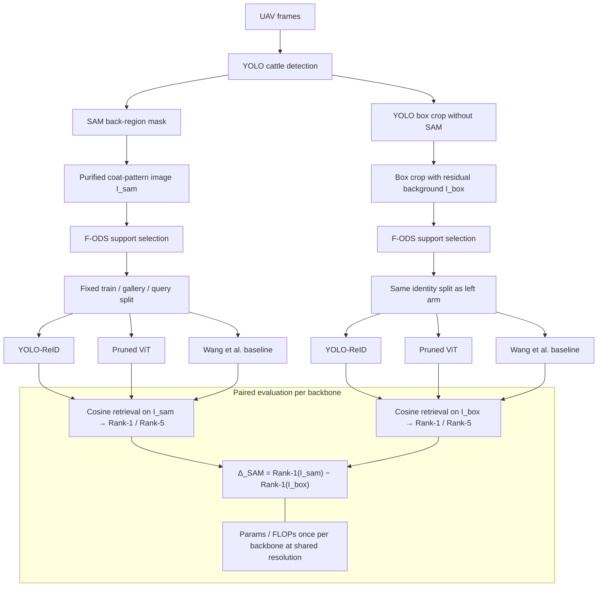

# Mutong: UAV-based Individual Cattle Identification

[](https://orcid.org/0000-0003-1167-621X)
[](https://doi.org/10.5281/zenodo.13364663)
[](requirements.txt)

**Tianyi Ma**, Zhengzhou University  
ORCID: [0000-0003-1167-621X](https://orcid.org/0000-0003-1167-621X) · GitHub: [@tianyi-star](https://github.com/tianyi-star)

## Abstract

Mutong (牧瞳) provides a controlled comparison of individual cattle re-identification from unmanned aerial vehicle (UAV) imagery of the dorsal coat pattern. Three embedding backbones—YOLO-ReID, a task-pruned Vision Transformer, and the coat-pattern metric-learning architecture of Wang *et al.*—are trained under a shared ArcFace objective. Each backbone is evaluated on two paired crops derived from the same detection: a Segment Anything Model (SAM) mask that retains the back-coat region, and a YOLO bounding-box crop that omits SAM. The resulting $2\times 3$ design isolates the contribution of background suppression from that of network architecture. Rank-1 and Rank-5 retrieval accuracy, together with parameter count and floating-point operations (FLOPs), constitute the reporting protocol. A method and experimental protocol draft is included in [`paper/method.tex`](paper/method.tex); measured recognition figures are produced by local training runs and are not embedded in this document.

## Method overview



Detection precedes the fork. For every UAV frame, a YOLO detector returns an axis-aligned cattle box that is shared by both experimental arms; the arms therefore differ in the retained pixels, not in the animal list. In the SAM arm, that box prompts a Segment Anything Model (SAM) mask of the dorsal coat, and the recogniser receives only the masked crop $I_{\mathrm{sam}}$. Pasture, hard shadow, and limbs that fall outside the mask are excluded. In the control arm, the same box crops the original frame to $I_{\mathrm{box}}$ and SAM is not applied, so background clutter may remain. Farm-aware optimal dataset selection (F-ODS) rebalances the training pool of each arm on its own crop manifest, while the few-shot assignment of identities to `train`, `gallery`, and `query` is held identical across all six cells. At test time, each query embedding is ranked against gallery embeddings by cosine similarity of $\ell_2$-normalised vectors; Rank-$\k$ is the fraction of queries whose true identity appears among the $\k$ nearest gallery identities. Parameter count and FLOPs are reported once per backbone at the common input resolution and exclude the ArcFace class-weight matrix, whose width scales with the number of training identities rather than with the crop operator.

The primary ablation question is:

> To what extent does a SAM mask that removes background, shadow, and limbs improve Rank-1 accuracy in cattle back-coat re-identification?

Formally, for a fixed backbone the gain is defined as

$$\Delta_{\mathrm{SAM}}=\mathrm{Rank\text{-}1}(I_{\mathrm{sam}})-\mathrm{Rank\text{-}1}(I_{\mathrm{box}}).$$

A positive value indicates that the mask raises Rank-1. The public implementation of this difference is `rank1_gain` in [`src/evaluate.py`](src/evaluate.py).

## Experimental design

The comparison comprises six cells formed by the Cartesian product of crop type and backbone.

| Input crop | YOLO-ReID (`yolo_arcface`) | Pruned ViT (`pruned_vit_arcface`) | Wang *et al.* (`wang_metric`) |
| --- | --- | --- | --- |
| SAM-purified back pattern | `sam` | `sam` | `sam` |
| YOLO box without SAM | `bbox` | `bbox` | `bbox` |

| Identifier | Role |
| --- | --- |
| `yolo_arcface` | Convolutional baseline: a YOLO-style trunk with the shared ArcFace head. |
| `pruned_vit_arcface` | Proposed recogniser: a Vision Transformer with structured pruning and the shared ArcFace head. |
| `wang_metric` | Baseline following Wang *et al.* (2025), retrained with the shared ArcFace head so that the loss is not a confounding factor. |

The coat-pattern deep metric learning method of Wang, Mücher, Wang, Wang, and Kooistra [*Computers and Electronics in Agriculture*, 2025](https://doi.org/10.1016/j.compag.2025.110754) supplies the third backbone. Released training artefacts are available as Zenodo record [10.5281/zenodo.13361729](https://doi.org/10.5281/zenodo.13361729); that code is not vendored here. Published figures from Wang *et al.* arise under a different training objective and must not be treated as results of the present protocol.

Shared hyperparameters—including image size, embedding dimension, ArcFace scale and margin, batch size, epoch budget, and learning rate—are recorded in [`configs/experiment.yaml`](configs/experiment.yaml). Any change to these values requires retraining of all six cells.

## ArcFace metric head

Training employs the additive angular margin loss of Deng, Guo, Xue, and Zafeiriou [*ArcFace*, CVPR 2019](https://doi.org/10.1109/CVPR.2019.00482). The same head is attached to every backbone and to both crops. A backbone maps a coat-pattern image to an embedding; the embedding and the rows of the class-weight matrix are $\ell_2$-normalised, so that their inner product equals the cosine of the angle between the sample and a class centre. ArcFace adds a margin $m$ to the target angle, scales all logits by $s$, and applies cross-entropy:

```text
target logit   = s * cos(theta_y + m)
other logits   = s * cos(theta_j),  j != y
```

At test time the class-weight matrix is discarded. Each network returns an $\ell_2$-normalised embedding, and gallery identities are ranked by cosine similarity.

| Symbol | Configuration key | Default |
| --- | --- | --- |
| $s$ | `arcface_scale` | 64.0 |
| $m$ | `arcface_margin` | 0.5 |
| embedding dimension | `embedding_dim` | 512 |

The implementation resides in [`src/arcface.py`](src/arcface.py) (`ArcFaceHead`).

## Dataset

The image source is the public UAV cattle archive of Wang *et al.*, Zenodo record [*Dataset for cattle growth monitoring in PLF using UAV-based LiDAR*](https://zenodo.org/records/13364663) ([10.5281/zenodo.13364663](https://doi.org/10.5281/zenodo.13364663), 23 August 2024, CC BY 4.0). The archive contains imagery associated with 96 Simmental beef cattle. This repository neither redistributes the archive nor asserts a fixed internal folder layout. After download, frames are placed under the directory named in `configs/path.yaml` and described by a CSV manifest. All entry scripts read that manifest rather than a hard-coded directory tree.

| File | Description | Size | Licence |
| --- | --- | --- | --- |
| `dataShare.zip` | UAV cattle archive deposited by Yaowu Wang | 26 486 342 645 bytes | CC BY 4.0 |

```bibtex
@dataset{wang2024uavlidar,
  author    = {Wang, Yaowu},
  title     = {Dataset for cattle growth monitoring in {PLF} using {UAV}-based {LiDAR}},
  year      = {2024},
  publisher = {Zenodo},
  doi       = {10.5281/zenodo.13364663},
  url       = {https://doi.org/10.5281/zenodo.13364663}
}
```

### Directory layout

Paths in [`configs/path.yaml`](configs/path.yaml) are resolved relative to the repository root unless absolute. Checkpoint fields ship empty and are filled locally; the software does not download weights.

```text
${ROOT}
|-- data
|   |-- raw                     raw_image_dir
|   |-- patterns                pattern_dir (SAM crops)
|   |-- bbox_crops              bbox_crop_dir (YOLO box crops)
|   |-- manifest.csv            manifest
|   |-- pattern_manifest.csv    pattern_manifest
|   |-- bbox_manifest.csv       bbox_manifest
|-- outputs
|   |-- yolo_arcface            SAM arm
|   |-- pruned_vit_arcface
|   |-- wang_metric
|   |-- yolo_arcface_bbox       control arm
|   |-- pruned_vit_arcface_bbox
|   |-- wang_metric_bbox
|-- configs
    |-- path.yaml
    |-- experiment.yaml
```

| Path key | Description |
| --- | --- |
| `raw_image_dir` | UAV frames supplied to detection |
| `manifest` | Identity table with columns `image_path`, `identity_id`, and `split` |
| `pattern_dir` | SAM-purified back-pattern crops |
| `pattern_manifest` | SAM-arm manifest (identical identities and splits; distinct pixels) |
| `bbox_crop_dir` | YOLO-box crops without SAM |
| `bbox_manifest` | Control-arm manifest |
| `yolo_weights` | Local YOLO detector checkpoint |
| `sam_weights` | Local SAM checkpoint |
| `output_dir` | Per-model output directories |
| `config` | Shared experiment configuration |

The field `split` takes values `train`, `gallery`, or `query`. Preprocessing copies the split onto both crop manifests so that all six cells share the same animals. Training uses `train` rows; evaluation ranks each `query` row against the `gallery` rows of the same manifest.

Example `manifest.csv`:

```text
image_path,identity_id,split
data/raw/c001_a.jpg,c001,train
data/raw/c001_b.jpg,c001,gallery
data/raw/c001_c.jpg,c001,query
```

## Installation

1. Obtain `dataShare.zip` from Zenodo and place the selected frames under `raw_image_dir`.
2. Construct `manifest.csv` with columns `image_path`, `identity_id`, and `split`.
3. Set `yolo_weights` and `sam_weights` in `configs/path.yaml` when detection and masking are required.
4. Create a Python 3.10+ environment and install dependencies:

```bash
python3 -m venv .venv
source .venv/bin/activate
pip install -r requirements.txt
```

Dependencies include PyTorch, torchvision, Ultralytics, timm, OpenCV, NumPy, Pillow, PyYAML, and tqdm. Entry points do not download checkpoints when printing help:

```bash
python3 -m src.preprocess --help
python3 -m src.train --help
python3 -m src.evaluate --help
```

## Usage

Scripts read `configs/path.yaml` and the shared experiment file. Paths may be overridden when modules are invoked directly.

### Background-removed identity folders

When dorsal-coat images for the 96 identities are already available as `READY/<identity_id>/*`, the SAM-arm manifest may be constructed without re-running detection:

```bash
sh scripts/prepare_ready.sh /path/to/READY sam
sh scripts/run_experiment.sh sam
```

This command sequence trains and evaluates YOLO-ReID, the pruned ViT, and the Wang *et al.* baseline under the shared ArcFace loss. Metrics are written to `outputs/*/metrics.json` and summarised in `outputs/summary_sam.json`.

A synthetic generator is provided solely to verify the pipeline in the absence of the archive; its outputs are not scientific results:

```bash
python3 -m src.make_synthetic --output-dir data/ready_bg_removed --num-identities 96
# optional: set config to configs/experiment_cpu.yaml for CPU-only hosts
sh scripts/prepare_ready.sh data/ready_bg_removed sam
sh scripts/run_experiment.sh sam
```

### Full $2\times 3$ protocol

1. Construct both crops from the same detections (`sam` for the purified arm; `bbox` for the control arm). The two manifests are not interchangeable.

```bash
sh scripts/preprocess.sh sam
sh scripts/preprocess.sh bbox
```

2. Train each cell. The second argument selects the crop and defaults to `sam`.

```bash
sh scripts/train.sh yolo_arcface sam
sh scripts/train.sh pruned_vit_arcface sam
sh scripts/train.sh wang_metric sam
sh scripts/train.sh yolo_arcface bbox
sh scripts/train.sh pruned_vit_arcface bbox
sh scripts/train.sh wang_metric bbox
```

3. Evaluate the corresponding cell. Reported fields are Rank-1, Rank-5, parameters, and FLOPs. The SAM gain for a backbone is Rank-1 on the `sam` cell minus Rank-1 on the `bbox` cell.

```bash
sh scripts/evaluate.sh yolo_arcface sam
sh scripts/evaluate.sh pruned_vit_arcface sam
sh scripts/evaluate.sh wang_metric sam
sh scripts/evaluate.sh yolo_arcface bbox
sh scripts/evaluate.sh pruned_vit_arcface bbox
sh scripts/evaluate.sh wang_metric bbox
```

Equivalent module entry points are `python3 -m src.preprocess`, `python3 -m src.train`, and `python3 -m src.evaluate`.

Principal components:

| Module | Responsibility |
| --- | --- |
| [`src/preprocess.py`](src/preprocess.py) | Detection, SAM or box cropping, and ingestion of ready identity folders |
| [`src/models.py`](src/models.py) | Backbone construction and ViT pruning |
| [`src/arcface.py`](src/arcface.py) | Shared ArcFace head |
| [`src/train.py`](src/train.py) | ArcFace optimisation loop |
| [`src/evaluate.py`](src/evaluate.py) | Rank-1 / Rank-5 retrieval and efficiency accounting |
| [`src/data.py`](src/data.py) | Manifest I/O and dataset construction |

## Repository layout

```text
.
├── LICENSE
├── CITATION.cff
├── README.md
├── requirements.txt
├── configs/
│   ├── experiment.yaml
│   ├── experiment_cpu.yaml
│   └── path.yaml
├── paper/
│   └── method.tex
├── scripts/
│   ├── prepare_ready.sh
│   ├── preprocess.sh
│   ├── train.sh
│   ├── evaluate.sh
│   └── run_experiment.sh
└── src/
    ├── protocol.py
    ├── config.py
    ├── data.py
    ├── preprocess.py
    ├── arcface.py
    ├── models.py
    ├── train.py
    ├── evaluate.py
    └── make_synthetic.py
```

Generated run directories, local image trees, and checkpoint files are excluded by `.gitignore`.

## Citation

Tianyi Ma, Zhengzhou University. ORCID: [0000-0003-1167-621X](https://orcid.org/0000-0003-1167-621X).

```bibtex
@software{ma2026mutong,
  author       = {Ma, Tianyi},
  orcid        = {0000-0003-1167-621X},
  title        = {Mutong: UAV-based Individual Cattle Identification},
  year         = {2026},
  organization = {Zhengzhou University},
  url          = {https://github.com/tianyi-star/2d_cattle},
  license      = {Apache-2.0}
}
```

```bibtex
@inproceedings{deng2019arcface,
  author    = {Deng, Jiankang and Guo, Jia and Xue, Niannan and Zafeiriou, Stefanos},
  title     = {ArcFace: Additive Angular Margin Loss for Deep Face Recognition},
  booktitle = {IEEE/CVF Conference on Computer Vision and Pattern Recognition},
  year      = {2019},
  doi       = {10.1109/CVPR.2019.00482},
  url       = {https://doi.org/10.1109/CVPR.2019.00482}
}
```

```bibtex
@article{wang2025coatdml,
  author  = {Wang, Yaowu and M{\"u}cher, C. A. and Wang, Kaiwen and Wang, Wensheng and Kooistra, Lammert},
  title   = {Deep metric learning for individual cattle identification using coat patterns: Proposal for a best practice},
  journal = {Computers and Electronics in Agriculture},
  year    = {2025},
  doi     = {10.1016/j.compag.2025.110754},
  url     = {https://doi.org/10.1016/j.compag.2025.110754}
}
```

## Funding

This work was supported by the Songshan Laboratory (No. 241110210200) and the Major Science and Technology Special Project of Henan Province (No. 221100210600).

## Licence

This software is distributed under the Apache License 2.0; see [LICENSE](LICENSE). The copyright notice is `Copyright 2026 Bo, Zhengzhou University / Mutong（牧瞳）`.

The Zenodo cattle archive remains under CC BY 4.0. That licence attaches to the dataset depositor and does not govern this software.
