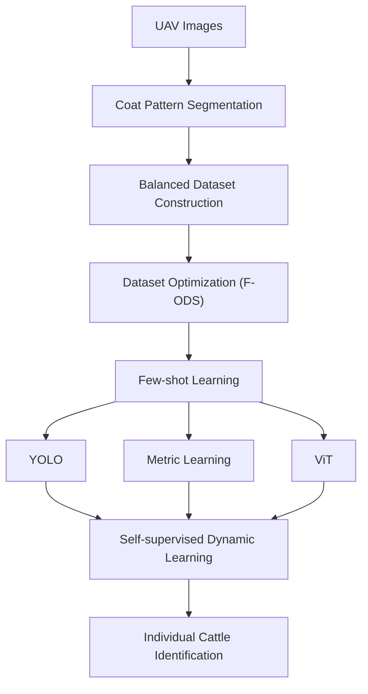

# Mutong: UAV-based Individual Cattle Identification

[](https://orcid.org/0000-0003-1167-621X)
[](https://doi.org/10.5281/zenodo.13364663)
[](requirements.txt)

**Tianyi Ma**, Zhengzhou University · [ORCID 0000-0003-1167-621X](https://orcid.org/0000-0003-1167-621X) · [GitHub @tianyi-star](https://github.com/tianyi-star)

Mutong (牧瞳) is the 2D stage of this project. It identifies individual cattle in UAV images from coat appearance. This repository holds that stage only: a public archive link, a local path file, and scripts for segmentation, dataset balancing, few-shot training, and identification. It does not distribute cattle images, trained weights, or measured recognition figures. 3D and 4D representations are later repositories, not modules in this one.



## Scope

The program has four questions. Only the first is in this repository.

| Stage | Question | Where it lives |
| --- | --- | --- |
| 1. Mutong, 2D | RQ1. How can individual cattle be identified from limited and imbalanced visual observations? | This repository: coat segmentation, F-ODS balancing, few-shot YOLO / metric / ViT, and a dynamic identity memory |
| 2. 3DGS | RQ2. Can the visual characteristics of an individual be represented in 3D, rather than only in 2D images? | A later repository. The first reconstruction target is the face |
| 3. 4DGS | RQ3. How can appearance and motion be represented continuously over time? RQ4. Can a dynamic Gaussian representation do that efficiently under natural movement? | A later repository. It needs a new multi-camera dataset and is aimed at walk replay and prediction |

Stage 2 starts only after stage 1 can attach an identity to a face crop through the manifest contract in this repository. Stage 3 starts only after a face can be reconstructed, and it does not reuse the current Zenodo archive as a walk dataset. RQ3 is the question. RQ4 names one candidate representation, 4D Gaussian splatting, rather than a second system.

## Data description

The image archive used with this project is Yaowu Wang's Zenodo record [Dataset for cattle growth monitoring in PLF using UAV-based LiDAR](https://zenodo.org/records/13364663) ([10.5281/zenodo.13364663](https://doi.org/10.5281/zenodo.13364663), 23 August 2024, CC BY 4.0). Zenodo describes it as the dataset for the data article "Integrated UAV-based LiDAR and RGB Data for Individual-Level Cattle Growth Monitoring in Precision Livestock Farming."

This repository does not unpack that archive for you and does not claim a folder layout inside it. After download, place the frames you use under the directory in `configs/path.yaml` and describe them with a CSV manifest. Every benchmark script reads that file rather than a hard-coded tree.

**Data file:** [Zenodo record](https://zenodo.org/records/13364663) · [DOI](https://doi.org/10.5281/zenodo.13364663)

| File | Description | Size | License |
| --- | --- | --- | --- |
| `dataShare.zip` | UAV cattle archive deposited by Yaowu Wang | 26,486,342,645 bytes | CC BY 4.0 |

```bibtex
@dataset{wang2024uavlidar,
  author    = {Wang, Yaowu},
  title     = {Dataset for cattle growth monitoring in {PLF} using {UAV}-based {LiDAR}},
  year      = {2024},
  publisher = {Zenodo},
  doi       = {10.5281/zenodo.13364663},
  url       = {https://doi.org/10.5281/zenodo.13364663}
}
```

### Local layout

Edit [`configs/path.yaml`](configs/path.yaml) so each entry points at your machine. Relative paths are resolved from the repository root.

```text
${ROOT}
|-- data
|   |-- raw                  image_dir
|   |-- masks                 mask_dir
|   |-- manifest.csv          manifest
|   |-- manifest_fods.csv     fods_manifest
|   |-- unlabeled.csv         unlabeled_manifest
|-- outputs
|   |-- metric
|   |-- vit
|   |-- yolo
|   |-- memory.pt
|-- configs
    |-- path.yaml
    |-- example.yaml
```

| Path key | Description | Required columns or contents |
| --- | --- | --- |
| `image_dir` | UAV frames passed to coat segmentation | image files |
| `manifest` | Labeled identity table | `image_path`, `identity_id`; optional `split`, `mask_path` |
| `fods_manifest` | Manifest after the F-ODS cap, with `sample_weight` | same columns plus `sample_weight` |
| `unlabeled_manifest` | Frames for the dynamic update | `image_path` |
| `mask_dir` | Coat masks written by segmentation | PNG masks |
| `encoder_checkpoint` | Metric-branch encoder spec | `encoder_spec.json` produced by training |
| `memory` | Enrolled identity prototypes | written by `enroll_memory.sh` |

`split`, when present, must be `train` or `val` on every row. The YOLO branch needs both values. The metric and ViT branches train on `train` rows, or on every row when `split` is absent, and they do not compute a validation figure.

A prototypical episode needs at least `n_way` identities, each with at least `k_shot + q_query` images. F-ODS keeps at most `shots` images per identity, so `shots` must stay at least `k_shot + q_query` when few-shot training reads `fods_manifest`. The triplet loss uses `k_shot` as the number of images per identity and requires `k_shot >= 2`. The numbers in `configs/example.yaml` are wiring defaults, not a reported schedule.

Example `manifest.csv`:

```text
image_path,identity_id,split
data/raw/c001_a.jpg,c001,train
data/raw/c001_b.jpg,c001,val
data/raw/c002_a.jpg,c002,train
```

Example `unlabeled.csv`:

```text
image_path
data/raw/frame_0001.jpg
data/raw/frame_0002.jpg
```

Paths inside a CSV are resolved from the working directory and, if that fails, from the CSV's directory. The ViT loader uses `sample_weight` when that column is present on every training row. Prototypical and triplet batches are class-balanced by their samplers.

## Setup

1. Download `dataShare.zip` from Zenodo and put the frames you will use in the `image_dir` from `configs/path.yaml`.
2. Write `manifest.csv` with `image_path` and `identity_id`.
3. Clone this repository and edit `configs/path.yaml` if your directories differ.
4. Create an environment and install dependencies. Python 3.10 or newer:

```bash
python3 -m venv .venv
source .venv/bin/activate
pip install -r requirements.txt
```

`requirements.txt` lists lower bounds for PyTorch, torchvision, Ultralytics, timm, OpenCV, NumPy, Pillow, PyYAML, tqdm, and scikit-learn. Training imports PyTorch, timm, and Ultralytics only when that command runs. No checkpoint is downloaded unless `--pretrained` is set. ImageNet initialization obtained that way is not a weight released by this project.

The entry points can be inspected before those packages are installed:

```bash
python3 -m src.coat_segmentation --help
python3 -m src.f_ods_dataset --help
python3 -m src.fewshot_train --help
python3 -m src.self_sup_dynamic --help
```

## Benchmarks

The scripts below are the reproducible entry points. They read `configs/path.yaml` and `configs/example.yaml`. They do not ship weights and they do not print a recognition figure. A training run logs only the loss of its own steps.

1. Segment coat regions. Without a segmentor checkpoint, the placeholder switch only checks that mask files can be written. Those masks are not coat annotations.

```bash
sh scripts/segment_coats.sh
sh scripts/segment_coats.sh --placeholder
```

2. Build the balanced F-ODS manifest. `score_samples` in `src/f_ods_dataset.py` returns `None`, so selection is a seeded shuffle within each identity. Replace that function with the experimental score before treating the subset as anything other than a class cap.

```bash
sh scripts/build_fods.sh
```

3. Train one few-shot branch. `triplet` is a metric loss, not a third branch name. The metric branch writes `outputs/metric/encoder_spec.json`. The ViT branch writes a classifier spec and is not the encoder used for the identity memory. The YOLO branch accepts an architecture yaml such as `yolov8n-cls.yaml` and refuses a `.pt` argument.

```bash
sh scripts/train_fewshot.sh metric
sh scripts/train_fewshot.sh metric triplet
sh scripts/train_fewshot.sh vit
sh scripts/train_fewshot.sh yolo
```

4. Enroll prototypes, update them from unlabeled frames, and identify one query. `update` does not create identities. `second_view` in `src/self_sup_dynamic.py` is a horizontal flip so the step can run; replace it with the experimental augmentation. `identify` prints one identity id and one cosine distance.

```bash
sh scripts/enroll_memory.sh
sh scripts/update_memory.sh
sh scripts/identify.sh
sh scripts/identify.sh path/to/query.jpg
```

The same commands are available as `python3 -m src.<module>`. Pass `--config configs/example.yaml` and the paths in `configs/path.yaml` when you call the modules directly.

Extension points:

- `score_samples` in `src/f_ods_dataset.py`
- `build_model` in `src/coat_segmentation.py`, once a segmentor architecture exists
- `PrototypicalLoss` and `BatchHardTripletLoss` in `src/fewshot_train.py`
- `second_view` and `NTXentLoss` in `src/self_sup_dynamic.py`

## Repository layout

```text
.
├── LICENSE
├── LICENSE.md
├── CITATION.cff
├── README.md
├── requirements.txt
├── configs/
│   ├── example.yaml
│   └── path.yaml
├── scripts/
│   ├── segment_coats.sh
│   ├── build_fods.sh
│   ├── train_fewshot.sh
│   ├── enroll_memory.sh
│   ├── update_memory.sh
│   └── identify.sh
└── src/
    ├── coat_segmentation.py
    ├── f_ods_dataset.py
    ├── fewshot_train.py
    └── self_sup_dynamic.py
```

Generated run directories, local image trees, and `*.pt` files are listed in `.gitignore`.

## Citation

Tianyi Ma, Zhengzhou University. ORCID: [0000-0003-1167-621X](https://orcid.org/0000-0003-1167-621X).

```bibtex
@software{ma2026mutong,
  author       = {Ma, Tianyi},
  orcid        = {0000-0003-1167-621X},
  title        = {Mutong: UAV-based Individual Cattle Identification},
  year         = {2026},
  organization = {Zhengzhou University},
  url          = {https://github.com/tianyi-star/2d_cattle},
  license      = {Apache-2.0 AND MIT}
}
```

## Funding

This work was supported by the Songshan Laboratory (No.241110210200) and Major Science and Technology Special Project of Henan Province (No.221100210600).

## License

This project is dual-licensed under the Apache License 2.0 and the MIT License.

The Apache License 2.0 is the license in [LICENSE](LICENSE). Its copyright notice is `Copyright 2026 Bo, Zhengzhou University / Mutong（牧瞳）`.

The MIT License notice below is retained verbatim from [LICENSE.md](LICENSE.md).

```text
MIT License

Copyright (c) 2026 Bo, Zhengzhou University / Mutong

Permission is hereby granted, free of charge, to any person obtaining a copy
of this software and associated documentation files (the "Software"), to deal
in the Software without restriction, including without limitation the rights
to use, copy, modify, merge, publish, distribute, sublicense, and/or sell
copies of the Software, and to permit persons to whom the Software is
furnished to do so, subject to the following conditions:

The above copyright notice and this permission notice shall be included in all
copies or substantial portions of the Software.

THE SOFTWARE IS PROVIDED "AS IS", WITHOUT WARRANTY OF ANY KIND, EXPRESS OR
IMPLIED, INCLUDING BUT NOT LIMITED TO THE WARRANTIES OF MERCHANTABILITY,
FITNESS FOR A PARTICULAR PURPOSE AND NONINFRINGEMENT. IN NO EVENT SHALL THE
AUTHORS OR COPYRIGHT HOLDERS BE LIABLE FOR ANY CLAIM, DAMAGES OR OTHER
LIABILITY, WHETHER IN AN ACTION OF CONTRACT, TORT OR OTHERWISE, ARISING FROM,
OUT OF OR IN CONNECTION WITH THE SOFTWARE OR THE USE OR OTHER DEALINGS IN THE
SOFTWARE.
```
