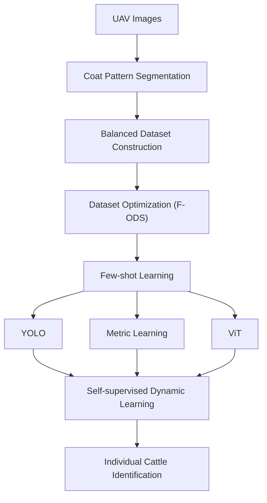

# Mutong: UAV-based Individual Cattle Identification

Mutong (牧瞳) is a research codebase for identifying individual cattle in images captured by an unmanned aerial vehicle (UAV). Coat appearance is localized before identity learning. Frames pass through coat-pattern segmentation, balanced dataset construction, and the F-ODS dataset-optimization step. A few-shot learner then maps appearance to an individual with one of three branches: a YOLO classifier, a metric-learning encoder, or a Vision Transformer. A self-supervised dynamic stage updates the enrolled identity memory from later unlabeled frames.

This repository is the software skeleton for that pipeline. It defines command-line entry points, the manifest contract, and the loss functions an experiment plugs into. It does not distribute cattle images, trained weights, or measured recognition figures.

## Pipeline

Segmentation writes a mask for each UAV frame. Those masks are available for later cropping or annotation; identity labels stay in a CSV manifest. F-ODS keeps at most a chosen number of images for each individual and attaches an inverse-frequency `sample_weight`. Few-shot training reads the resulting manifest. The metric branch saves an embedding encoder. Dynamic learning enrolls one prototype per individual from that encoder, takes a normalized temperature-scaled cross-entropy step on unlabeled frames, and moves the nearest prototype. Identification returns the nearest enrolled individual and the cosine distance of one query.



## Repository layout

```text
.
├── LICENSE                  Apache License 2.0
├── LICENSE.md               MIT License
├── README.md
├── requirements.txt
├── configs/example.yaml     wiring defaults, not measured results
└── src/
    ├── __init__.py
    ├── coat_segmentation.py
    ├── f_ods_dataset.py
    ├── fewshot_train.py
    └── self_sup_dynamic.py
```

Generated run directories, local image trees, and `*.pt` files are listed in `.gitignore`.

## Environment

Python 3.10 or newer is required. Training imports PyTorch, timm, and Ultralytics only when the corresponding command runs. No checkpoint is downloaded unless `--pretrained` is set for a timm backbone. ImageNet initialization obtained that way is not a weight released by this project.

```bash
python -m venv .venv
source .venv/bin/activate
pip install -r requirements.txt
```

`requirements.txt` lists lower bounds for PyTorch, torchvision, Ultralytics, timm, OpenCV, NumPy, Pillow, PyYAML, tqdm, and scikit-learn. The current commands call PyTorch, Ultralytics, timm, OpenCV, and PyYAML. torchvision, tqdm, and scikit-learn are declared for experiments that replace the hooks in `src/`.

The entry points can be inspected before those packages are installed:

```bash
python -m src.coat_segmentation --help
python -m src.f_ods_dataset --help
python -m src.fewshot_train --help
python -m src.self_sup_dynamic --help
```

## Dataset

No cattle dataset is redistributed here. Place a private UAV collection on disk and describe it with a CSV. Paths are resolved from the working directory and, if that fails, from the directory that contains the CSV.

Labeled manifest, `data/manifest.csv`:

```text
image_path,identity_id,split
data/raw/c001_a.jpg,c001,train
data/raw/c001_b.jpg,c001,val
data/raw/c002_a.jpg,c002,train
```

`image_path` and `identity_id` are required. `split` is optional. When the column is present, every value must be `train` or `val`. The YOLO branch requires both splits. The metric and ViT branches train on `train` rows, or on every row when `split` is absent, and they do not compute a validation figure. `mask_path` is optional. The segmentation command can add it. F-ODS preserves extra columns and writes `sample_weight`.

The block above shows the schema only. A prototypical episode needs at least `n_way` identities, each with at least `k_shot + q_query` images. F-ODS keeps at most `shots` images per identity, so `shots` must remain at least `k_shot + q_query` when the optimized manifest is the training input. The triplet loss uses `k_shot` as the number of images per identity in a batch and requires `k_shot >= 2`. `configs/example.yaml` follows those constraints. Its numeric values are placeholders for a wiring run.

Unlabeled frames for the dynamic update, `data/unlabeled.csv`:

```text
image_path
data/raw/frame_0001.jpg
data/raw/frame_0002.jpg
```

The ViT loader uses `sample_weight` when that column is present on every training row. Prototypical and triplet batches are class-balanced by their samplers instead.

## Training and inference

`configs/example.yaml` holds the shared defaults. Command-line flags override it. `--branch` always selects the few-shot learner, including when the file also contains a `branch` key.

Coat segmentation expects an `nn.Module` saved with `torch.save`. The forward contract is documented in `src/coat_segmentation.py`. This repository does not contain a segmentor checkpoint. `--placeholder` runs a coarse color threshold so the mask files can be checked before a segmentor exists. Masks from that mode are not coat annotations.

```bash
python -m src.coat_segmentation \
  --images data/raw \
  --output data/masks \
  --checkpoint path/to/segmentor.pt \
  --config configs/example.yaml \
  --index data/mask_index.csv

python -m src.coat_segmentation \
  --manifest data/manifest.csv \
  --output data/masks \
  --placeholder \
  --index data/manifest_masks.csv
```

F-ODS writes a balanced manifest and does not train. `score_samples` in `src/f_ods_dataset.py` is the feature-level hook. It returns `None`, and the sampler then shuffles within each identity using `--seed`. Replace that function with the experimental score before treating the selection as anything other than a cap on class count.

```bash
python -m src.f_ods_dataset \
  --manifest data/manifest.csv \
  --output data/manifest_fods.csv \
  --config configs/example.yaml
```

Few-shot training:

```bash
python -m src.fewshot_train \
  --branch metric \
  --manifest data/manifest_fods.csv \
  --config configs/example.yaml

python -m src.fewshot_train \
  --branch metric \
  --metric-loss triplet \
  --manifest data/manifest_fods.csv \
  --config configs/example.yaml

python -m src.fewshot_train \
  --branch vit \
  --manifest data/manifest_fods.csv \
  --config configs/example.yaml

python -m src.fewshot_train \
  --branch yolo \
  --manifest data/manifest_fods.csv \
  --config configs/example.yaml
```

The metric branch writes `outputs/metric/encoder_spec.json` and `encoder_state.pt`. The ViT branch writes a classifier spec under `outputs/vit/`. Dynamic learning should load the metric encoder, not that classifier. The YOLO branch accepts an architecture yaml such as `yolov8n-cls.yaml` and refuses a `.pt` model argument, so the command does not fetch a weight file. A run logs the mean training loss of its own steps. That log is not a result reported by this repository.

Self-supervised update and identification use the metric encoder spec:

```bash
python -m src.self_sup_dynamic enroll \
  --manifest data/manifest_fods.csv \
  --memory outputs/memory.pt \
  --checkpoint outputs/metric/encoder_spec.json \
  --config configs/example.yaml

python -m src.self_sup_dynamic update \
  --unlabeled data/unlabeled.csv \
  --memory outputs/memory.pt \
  --checkpoint outputs/metric/encoder_spec.json \
  --config configs/example.yaml

python -m src.self_sup_dynamic identify \
  --query data/raw/query.jpg \
  --memory outputs/memory.pt \
  --checkpoint outputs/metric/encoder_spec.json \
  --config configs/example.yaml
```

`enroll` stores the mean embedding of each identity. `update` does not create identities: each unlabeled embedding is assigned to the nearest prototype, and that prototype takes an exponential moving average. `second_view` in `src/self_sup_dynamic.py` is a horizontal flip so the step can run; replace it with the experimental augmentation. `identify` prints one identity id and one cosine distance. It does not aggregate queries.

Extension points, all left open for the experiment:

- `score_samples` in `src/f_ods_dataset.py`
- `build_model` in `src/coat_segmentation.py`, once a segmentor architecture exists
- `PrototypicalLoss` and `BatchHardTripletLoss` in `src/fewshot_train.py`
- `second_view` and `NTXentLoss` in `src/self_sup_dynamic.py`

## Citation

```bibtex
@software{bo2026mutong,
  author       = {Bo},
  title        = {Mutong: UAV-based Individual Cattle Identification},
  year         = {2026},
  organization = {Zhengzhou University},
  url          = {https://github.com/tianyi-star/2d_cattle},
  license      = {Apache-2.0 AND MIT}
}
```

## License

This project is dual-licensed under the Apache License 2.0 and the MIT License.

The Apache License 2.0 is the license in [LICENSE](LICENSE). Its copyright notice is `Copyright 2026 Bo, Zhengzhou University / Mutong（牧瞳）`.

The MIT License notice below is retained verbatim from [LICENSE.md](LICENSE.md).

```text
MIT License

Copyright (c) 2026 Bo, Zhengzhou University / Mutong

Permission is hereby granted, free of charge, to any person obtaining a copy
of this software and associated documentation files (the "Software"), to deal
in the Software without restriction, including without limitation the rights
to use, copy, modify, merge, publish, distribute, sublicense, and/or sell
copies of the Software, and to permit persons to whom the Software is
furnished to do so, subject to the following conditions:

The above copyright notice and this permission notice shall be included in all
copies or substantial portions of the Software.

THE SOFTWARE IS PROVIDED "AS IS", WITHOUT WARRANTY OF ANY KIND, EXPRESS OR
IMPLIED, INCLUDING BUT NOT LIMITED TO THE WARRANTIES OF MERCHANTABILITY,
FITNESS FOR A PARTICULAR PURPOSE AND NONINFRINGEMENT. IN NO EVENT SHALL THE
AUTHORS OR COPYRIGHT HOLDERS BE LIABLE FOR ANY CLAIM, DAMAGES OR OTHER
LIABILITY, WHETHER IN AN ACTION OF CONTRACT, TORT OR OTHERWISE, ARISING FROM,
OUT OF OR IN CONNECTION WITH THE SOFTWARE OR THE USE OR OTHER DEALINGS IN THE
SOFTWARE.
```
