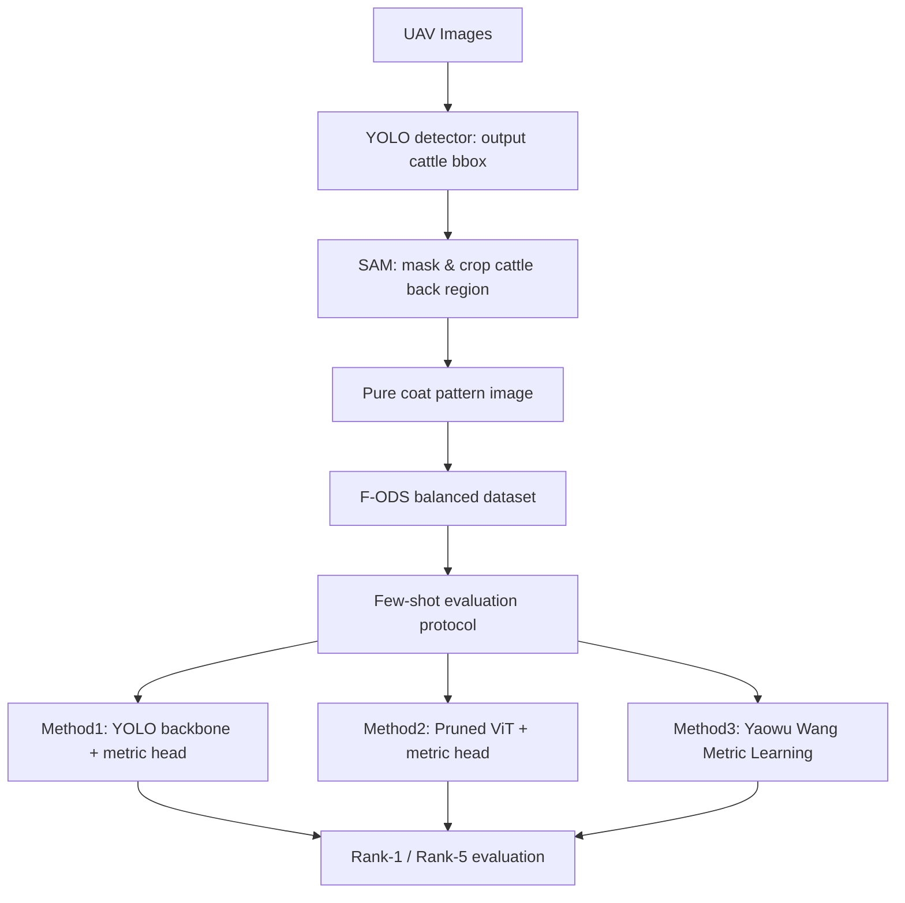

# Mutong: UAV-based Individual Cattle Identification

[](https://orcid.org/0000-0003-1167-621X)
[](https://doi.org/10.5281/zenodo.13364663)
[](requirements.txt)

**Tianyi Ma**, Zhengzhou University · [ORCID 0000-0003-1167-621X](https://orcid.org/0000-0003-1167-621X) · [GitHub @tianyi-star](https://github.com/tianyi-star)

Mutong (牧瞳) compares three identification models on UAV images of the cattle back coat. The models share the path in the figure below: one detector, one SAM crop, one balanced set, and one few-shot protocol. The metric head on every model is ArcFace.

This repository is the public skeleton. It keeps the interfaces, the path file, and the entry scripts. The image archive, the checkpoints, and the training and measurement code stay on the private Ubuntu server. No recognition figure is stored here.



YOLO returns a cattle box. SAM builds a mask from that box and crops the back region, which is the pure coat-pattern image used from that point on. F-ODS then builds the balanced identity set those three methods share. The few-shot protocol fixes the same `train`, `gallery`, and `query` rows for every method. Rank-1 and Rank-5 are the fraction of query images whose identity appears among the nearest gallery identities. The same runs also record parameter count and FLOPs. A YOLO-box crop that skips SAM remains available as a reserved control in the scripts. It is outside this figure and outside the three-method table.

## Models

| Figure | Name | Role |
| --- | --- | --- |
| Method1 | `yolo_arcface` | CNN baseline. YOLO backbone and the shared ArcFace metric head. |
| Method2 | `pruned_vit_arcface` | Proposed model. Pruned Vision Transformer and the shared ArcFace metric head. |
| Method3 | `wang_metric` | Metric-learning baseline following Wang et al. (2025), trained with the same ArcFace metric head. |

Wang, Mücher, Wang, Wang, and Kooistra, [Deep metric learning for individual cattle identification using coat patterns](https://doi.org/10.1016/j.compag.2025.110754), Computers and Electronics in Agriculture, 2025. Their released training code is the Zenodo record [10.5281/zenodo.13361729](https://doi.org/10.5281/zenodo.13361729). This repository does not vendor that code. Method3 keeps their backbone as the baseline and trains it with ArcFace, so the loss is not a difference between the three methods. Figures reported in that paper are not results of this repository.

## ArcFace

ArcFace is the additive angular margin loss of Deng, Guo, Xue, and Zafeiriou, [ArcFace: Additive Angular Margin Loss for Deep Face Recognition](https://doi.org/10.1109/CVPR.2019.00482), CVPR 2019. In this project it is the metric head drawn on Method1, Method2, and Method3. The three backbones differ. The head does not.

A backbone maps one coat-pattern image to an embedding. During training, that embedding and the rows of the class-weight matrix are L2-normalized. Their dot product is then the cosine of the angle between the sample and a class center. ArcFace adds a margin to the angle of the true identity, scales every cosine, and applies cross-entropy:

```text
target logit   = s * cos(theta_y + m)
other logits   = s * cos(theta_j),  j != y
```

`s` is the scale and `m` is the angular margin in radians. The margin makes the true class occupy a tighter cone on the hypersphere and pushes other identities away. That is the geometry used at test time: the class-weight matrix is dropped, each network returns an L2-normalized embedding, and Rank-1 / Rank-5 rank the gallery by cosine distance.

The shared values live in [`configs/experiment.yaml`](configs/experiment.yaml). They are the common training settings, not a measured result. Changing one of them means retraining all three methods.

| Symbol | Config key | Value in the public file |
| --- | --- | --- |
| `s` | `arcface_scale` | 64.0 |
| `m` | `arcface_margin` | 0.5 |
| embedding size | `embedding_dim` | 512 |

Parameter count and FLOPs are taken on the inference embedding network at the shared image size. The ArcFace class-weight matrix is left out of both counts, because its width follows the number of training identities. The public class is `ArcFaceHead` in [`src/arcface.py`](src/arcface.py). Its `forward` is implemented on the private server.

## Data description

The image archive used with this project is Yaowu Wang's Zenodo record [Dataset for cattle growth monitoring in PLF using UAV-based LiDAR](https://zenodo.org/records/13364663) ([10.5281/zenodo.13364663](https://doi.org/10.5281/zenodo.13364663), 23 August 2024, CC BY 4.0).

This repository does not unpack that archive and does not claim a folder layout inside it. After download, place the frames under the directory in `configs/path.yaml` and describe them with a CSV manifest. Every script reads that file rather than a hard-coded tree.

**Data file:** [Zenodo record](https://zenodo.org/records/13364663) · [DOI](https://doi.org/10.5281/zenodo.13364663)

| File | Description | Size | License |
| --- | --- | --- | --- |
| `dataShare.zip` | UAV cattle archive deposited by Yaowu Wang | 26,486,342,645 bytes | CC BY 4.0 |

```bibtex
@dataset{wang2024uavlidar,
  author    = {Wang, Yaowu},
  title     = {Dataset for cattle growth monitoring in {PLF} using {UAV}-based {LiDAR}},
  year      = {2024},
  publisher = {Zenodo},
  doi       = {10.5281/zenodo.13364663},
  url       = {https://doi.org/10.5281/zenodo.13364663}
}
```

### Local layout

Edit [`configs/path.yaml`](configs/path.yaml) so each entry points at the private server. Relative paths are resolved from the repository root. Checkpoint entries ship empty. Filling them does not make this repository download a weight file.

```text
${ROOT}
|-- data
|   |-- raw                     raw_image_dir
|   |-- patterns                pattern_dir, shared SAM crops
|   |-- bbox_crops              bbox_crop_dir, reserved control
|   |-- manifest.csv            manifest
|   |-- pattern_manifest.csv    pattern_manifest
|   |-- bbox_manifest.csv       bbox_manifest
|-- outputs
|   |-- yolo_arcface
|   |-- pruned_vit_arcface
|   |-- wang_metric
|-- configs
    |-- path.yaml
    |-- experiment.yaml
```

| Path key | Description |
| --- | --- |
| `raw_image_dir` | UAV frames passed to YOLO detection |
| `manifest` | Identity table with `image_path`, `identity_id`, and `split` |
| `pattern_dir` | SAM-purified back-pattern crops |
| `pattern_manifest` | Same identities and splits, with `image_path` pointing at those crops |
| `bbox_crop_dir` | Reserved original-frame crops from the YOLO box |
| `bbox_manifest` | Manifest for that reserved control |
| `yolo_weights` | Local YOLO checkpoint. Empty in the public file |
| `sam_weights` | Local SAM checkpoint. Empty in the public file |
| `output_dir` | One subdirectory per model, written by the private training run |
| `config` | Shared experiment file |

`split` is `train`, `gallery`, or `query`. The three training commands read `pattern_manifest` and use the `train` rows. Evaluation ranks every `query` row against the `gallery` rows in that same file.

Example `manifest.csv`:

```text
image_path,identity_id,split
data/raw/c001_a.jpg,c001,train
data/raw/c001_b.jpg,c001,gallery
data/raw/c001_c.jpg,c001,query
```

## Setup

1. Download `dataShare.zip` from Zenodo and put the frames you will use in `raw_image_dir`.
2. Write `manifest.csv` with `image_path`, `identity_id`, and `split`.
3. On the private server, set `yolo_weights` and `sam_weights` to local checkpoint files.
4. Clone this repository and edit `configs/path.yaml` if your directories differ.
5. Create an environment and install dependencies. Python 3.10 or newer:

```bash
python3 -m venv .venv
source .venv/bin/activate
pip install -r requirements.txt
```

`requirements.txt` lists the libraries the private server is expected to provide: PyTorch, torchvision, Ultralytics, timm, OpenCV, NumPy, Pillow, PyYAML, and tqdm. The public entry points do not import those packages while printing help, and they do not download a checkpoint.

```bash
python3 -m src.preprocess --help
python3 -m src.train --help
python3 -m src.evaluate --help
```

## Commands

The scripts read `configs/path.yaml` and `configs/experiment.yaml`. They stop at the public interface. Detection, SAM prompting, pruning, the ArcFace optimisation loop, and the four measurements are implemented on the private server.

1. Build the shared SAM crops. `sam` is the default. `bbox` is the reserved control and stops with an explanation.

```bash
sh scripts/preprocess.sh
sh scripts/preprocess.sh sam
sh scripts/preprocess.sh bbox
```

2. Train one model on `pattern_manifest`. The second argument defaults to `sam`. Passing `bbox` selects the reserved control and does not train.

```bash
sh scripts/train.sh yolo_arcface
sh scripts/train.sh pruned_vit_arcface
sh scripts/train.sh wang_metric
```

3. Evaluate the matching run. The four fields are Rank-1, Rank-5, parameters, and FLOPs. The command does not print a placeholder number.

```bash
sh scripts/evaluate.sh yolo_arcface
sh scripts/evaluate.sh pruned_vit_arcface
sh scripts/evaluate.sh wang_metric
```

The same commands are available as `python3 -m src.preprocess`, `python3 -m src.train`, and `python3 -m src.evaluate`. Pass the paths from `configs/path.yaml` when you call the modules directly.

What the private server fills in:

- YOLO inference and the SAM prompt that keeps the back coat pattern, in `src/preprocess.py`
- Backbone construction and ViT pruning, in `src/models.py`
- `ArcFaceHead.forward`, in `src/arcface.py`
- The optimisation loop, in `src/train.py`
- Rank-1, Rank-5, parameter, and FLOP measurement, in `src/evaluate.py`

## Repository layout

```text
.
├── LICENSE                  Apache License 2.0
├── CITATION.cff
├── README.md
├── requirements.txt
├── configs/
│   ├── experiment.yaml
│   └── path.yaml
├── scripts/
│   ├── preprocess.sh
│   ├── train.sh
│   └── evaluate.sh
└── src/
    ├── protocol.py
    ├── config.py
    ├── preprocess.py
    ├── arcface.py
    ├── models.py
    ├── train.py
    └── evaluate.py
```

Generated run directories, local image trees, and checkpoint files are listed in `.gitignore`.

## Citation

Tianyi Ma, Zhengzhou University. ORCID: [0000-0003-1167-621X](https://orcid.org/0000-0003-1167-621X).

```bibtex
@software{ma2026mutong,
  author       = {Ma, Tianyi},
  orcid        = {0000-0003-1167-621X},
  title        = {Mutong: UAV-based Individual Cattle Identification},
  year         = {2026},
  organization = {Zhengzhou University},
  url          = {https://github.com/tianyi-star/2d_cattle},
  license      = {Apache-2.0}
}
```

```bibtex
@inproceedings{deng2019arcface,
  author    = {Deng, Jiankang and Guo, Jia and Xue, Niannan and Zafeiriou, Stefanos},
  title     = {ArcFace: Additive Angular Margin Loss for Deep Face Recognition},
  booktitle = {IEEE/CVF Conference on Computer Vision and Pattern Recognition},
  year      = {2019},
  doi       = {10.1109/CVPR.2019.00482},
  url       = {https://doi.org/10.1109/CVPR.2019.00482}
}
```

```bibtex
@article{wang2025coatdml,
  author  = {Wang, Yaowu and M{\"u}cher, C. A. and Wang, Kaiwen and Wang, Wensheng and Kooistra, Lammert},
  title   = {Deep metric learning for individual cattle identification using coat patterns: Proposal for a best practice},
  journal = {Computers and Electronics in Agriculture},
  year    = {2025},
  doi     = {10.1016/j.compag.2025.110754},
  url     = {https://doi.org/10.1016/j.compag.2025.110754}
}
```

## Funding

This work was supported by the Songshan Laboratory (No.241110210200) and Major Science and Technology Special Project of Henan Province (No.221100210600).

## License

This software is licensed under the Apache License 2.0. The full text is in [LICENSE](LICENSE). The copyright notice is `Copyright 2026 Bo, Zhengzhou University / Mutong（牧瞳）`.

The Zenodo cattle archive remains under CC BY 4.0. That license belongs to the dataset depositor and does not apply to this code.
