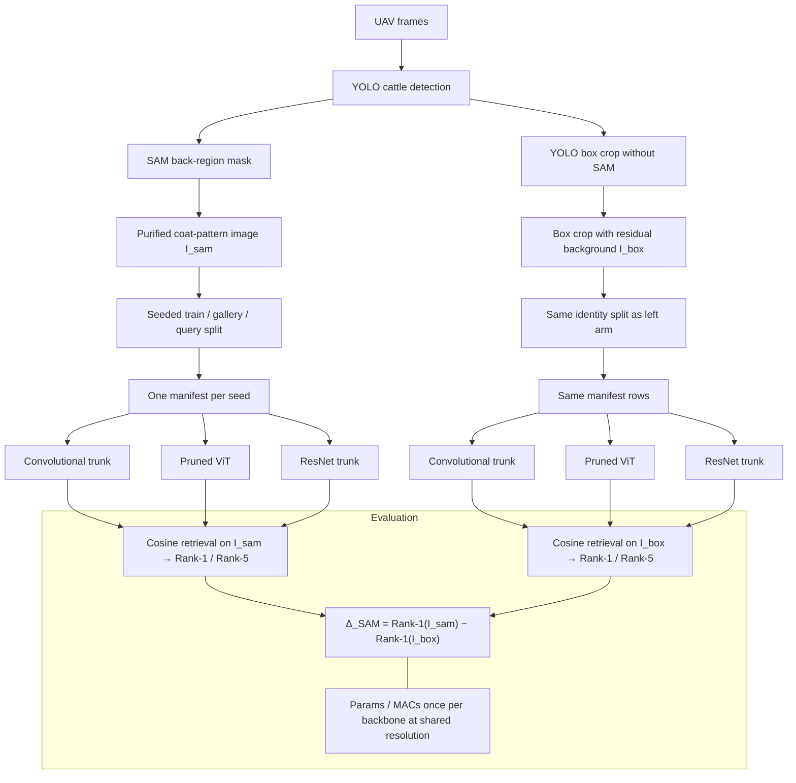

# Mutong: UAV-based Individual Cattle Identification

[](https://orcid.org/0000-0003-1167-621X)
[](https://doi.org/10.5281/zenodo.13364663)
[](requirements.txt)

**Tianyi Ma**, Zhengzhou University  
ORCID: [0000-0003-1167-621X](https://orcid.org/0000-0003-1167-621X) · GitHub: [@tianyi-star](https://github.com/tianyi-star)

## Abstract

Mutong provides a controlled comparison of individual cattle re-identification from low-altitude unmanned aerial vehicle (UAV) RGB imagery of the dorsal coat pattern, using the openly released Zenodo archive of 96 Simmental beef cattle (Wang *et al.*, 2024) held locally. Three embedding backbones—a compact convolutional trunk (called YOLO-ReID for historical reasons, though it is not a YOLO network), a task-pruned Vision Transformer, and a ResNet trunk standing in for the coat-pattern metric-learning line of Wang *et al.*—are trained under a shared ArcFace objective. Each backbone is evaluated on two paired crops derived from the same detection: a Segment Anything Model (SAM) mask that retains the back-coat region, and a bounding-box crop that omits SAM. The resulting $2\times 3$ design isolates the contribution of background suppression from that of network architecture. Evaluation is on an identity-disjoint partition, so no animal appears in more than one of the training, validation and test sets. Rank-1 and Rank-5 retrieval accuracy, together with parameter count and multiply-accumulates (MACs), constitute the reporting protocol. A method and experimental protocol draft is included in [`paper/method.tex`](paper/method.tex); the CEA manuscript is [`paper/manuscript-cea.md`](paper/manuscript-cea.md). Measured recognition figures are produced by local training runs and are not embedded in this document.

## Method overview



Detection precedes the fork. For every UAV frame, a YOLO detector returns an axis-aligned cattle box that is shared by both experimental arms; the arms therefore differ in the retained pixels, not in the animal list. In the SAM arm, that box prompts a Segment Anything Model (SAM) mask of the dorsal coat, and the recogniser receives only the masked crop $I_{\mathrm{sam}}$. Pasture, hard shadow, and limbs that fall outside the mask are excluded. In the control arm, the same box crops the original frame to $I_{\mathrm{box}}$ and SAM is not applied, so background clutter may remain. The seeded assignment of identities to `train`, `gallery`, and `query` is held identical across all six cells. At test time, each query embedding is ranked against gallery embeddings by cosine similarity of $\ell_2$-normalised vectors; Rank- $k$ is the fraction of queries whose true identity appears among the $k$ nearest gallery identities. Parameter count and multiply-accumulates (MACs) are reported once per backbone at the common input resolution and exclude the ArcFace class-weight matrix, whose width scales with the number of training identities rather than with the crop operator.

The primary ablation question is:

> To what extent does a SAM mask that removes background, shadow, and limbs improve Rank-1 accuracy in cattle back-coat re-identification?

Formally, for a fixed backbone the gain is defined as

$$\Delta_{\mathrm{SAM}}=\mathrm{Rank\text{-}1}(I_{\mathrm{sam}})-\mathrm{Rank\text{-}1}(I_{\mathrm{box}}).$$

A positive value indicates that the mask raises Rank-1. The public implementation of this difference is `rank1_gain` in [`src/evaluate.py`](src/evaluate.py).

## Experimental design

The comparison comprises six cells formed by the Cartesian product of crop type and backbone.

| Input crop | YOLO-ReID (`yolo_arcface`) | Pruned ViT (`pruned_vit_arcface`) | Wang *et al.* (`wang_metric`) |
| --- | --- | --- | --- |
| SAM-purified back pattern | `sam` | `sam` | `sam` |
| YOLO box without SAM | `bbox` | `bbox` | `bbox` |

| Identifier | Role |
| --- | --- |
| `yolo_arcface` | Convolutional baseline: a compact five-stage conv-BN-SiLU trunk with the shared ArcFace head. Called YOLO-ReID for historical reasons; it is **not** a YOLO network and shares no weights with the detector. |
| `pruned_vit_arcface` | Proposed recogniser: a Vision Transformer with structured pruning and the shared ArcFace head. |
| `wang_metric` | A ResNet-50 trunk with random initialisation, trained with the shared ArcFace head. It stands in for the coat-pattern metric-learning line of Wang *et al.* (2025); it is **not** a reproduction of their architecture or objective. |

The coat-pattern deep metric learning method of Wang, Mücher, Wang, Wang, and Kooistra [*Computers and Electronics in Agriculture*, 2025](https://doi.org/10.1016/j.compag.2025.110754) supplies the third backbone. Released training artefacts are available as Zenodo record [10.5281/zenodo.13361729](https://doi.org/10.5281/zenodo.13361729); that code is not vendored here. Published figures from Wang *et al.* arise under a different training objective and must not be treated as results of the present protocol.

Shared hyperparameters—including image size, embedding dimension, ArcFace scale and margin, batch size, epoch budget, and learning rate—are recorded in [`configs/experiment.yaml`](configs/experiment.yaml). Any change to these values requires retraining of all six cells.

## ArcFace metric head

Training employs the additive angular margin loss of Deng, Guo, Xue, and Zafeiriou [*ArcFace*, CVPR 2019](https://doi.org/10.1109/CVPR.2019.00482). The same head is attached to every backbone and to both crops. A backbone maps a coat-pattern image to an embedding; the embedding and the rows of the class-weight matrix are $\ell_2$-normalised, so that their inner product equals the cosine of the angle between the sample and a class centre. ArcFace adds a margin $m$ to the target angle, scales all logits by $s$, and applies cross-entropy:

```text
target logit   = s * cos(theta_y + m)
other logits   = s * cos(theta_j),  j != y
```

At test time the class-weight matrix is discarded. Each network returns an $\ell_2$-normalised embedding, and gallery identities are ranked by cosine similarity.

| Symbol | Configuration key | Default |
| --- | --- | --- |
| $s$ | `arcface_scale` | 64.0 |
| $m$ | `arcface_margin` | 0.5 |
| embedding dimension | `embedding_dim` | 512 |

The implementation resides in [`src/arcface.py`](src/arcface.py) (`ArcFaceHead`).

## Dataset

The imagery analysed in this project is obtained from the Zenodo archive of Wang *et al.*
(2024), record [`10.5281/zenodo.13364663`](https://doi.org/10.5281/zenodo.13364663) (CC BY 4.0),
**downloaded and stored locally** on the GPU server as one directory per animal:

```text
/home/iadi/UAV-basedData/RGB-data/individaulsByIds/<identity_id>/*.{jpg,png,...}
```

Identity directory names are the herd identifiers and are **not contiguous** (they span
`101`–`328` while numbering 96 animals), so the archive must be described by its identity count,
never by its identifier range.

| Property | Value |
| --- | --- |
| Source | Zenodo `10.5281/zenodo.13364663` (Wang 2024, CC BY 4.0), held locally |
| Modality | UAV RGB, low-altitude aerial, dorsal aspect |
| Identities | 96 Simmental male beef cattle (per companion record `10.5281/zenodo.13361729`) |
| Layout | one directory per identity in the local copy |
| Publicly available? | **Yes** — Zenodo, CC BY 4.0. The local copy is a convenience, not a separate collection. |
| Capture parameters | documented in the data article (Wang et al. 2025, *Sci. Data* 12:1318, doi `10.1038/s41597-025-04783-6`); RGB optics to be confirmed |

This project applies an identification protocol to that public archive; it does not collect or
redistribute new imagery.

> **Split requirement.** Identities must be partitioned **disjointly** into train / validation /
> test — never by shuffling images. Consecutive UAV frames of one animal are near-duplicates, so an
> image-level split lets the model retrieve a memorised frame rather than an animal and inflates
> rank-1. See `paper/manuscript-cea.md` §3.2.1 for the rationale.
>
> **Not yet implemented.** `src/data.py:build_split_rows()` currently shuffles each identity's own
> images into train/gallery/query, so every identity lands in all three sets, and no `val` split
> exists (`SPLITS = ("train", "gallery", "query")`). Any rank-1 produced by the current pipeline is
> inflated. This is tracked as gap item 1 in `paper/evidence-audit.md` §8.

### Directory layout

Paths in [`configs/path.yaml`](configs/path.yaml) are resolved relative to the repository root unless absolute. Checkpoint fields ship empty and are filled locally; the software does not download weights.

```text
${ROOT}
|-- data
|   |-- raw                     raw_image_dir
|   |-- patterns                pattern_dir (SAM crops)
|   |-- bbox_crops              bbox_crop_dir (YOLO box crops)
|   |-- manifest.csv            manifest
|   |-- pattern_manifest.csv    pattern_manifest
|   |-- bbox_manifest.csv       bbox_manifest
|-- outputs
|   |-- yolo_arcface            SAM arm
|   |-- pruned_vit_arcface
|   |-- wang_metric
|   |-- yolo_arcface_bbox       control arm
|   |-- pruned_vit_arcface_bbox
|   |-- wang_metric_bbox
|-- configs
    |-- path.yaml
    |-- experiment.yaml
```

| Path key | Description |
| --- | --- |
| `raw_image_dir` | UAV frames supplied to detection |
| `manifest` | Identity table with columns `image_path`, `identity_id`, and `split` |
| `pattern_dir` | SAM-purified back-pattern crops |
| `pattern_manifest` | SAM-arm manifest (identical identities and splits; distinct pixels) |
| `bbox_crop_dir` | YOLO-box crops without SAM |
| `bbox_manifest` | Control-arm manifest |
| `yolo_weights` | Local YOLO detector checkpoint |
| `sam_weights` | Local SAM checkpoint |
| `output_dir` | Per-model output directories |
| `config` | Shared experiment configuration |

The field `split` takes values `train`, `gallery`, or `query`. Preprocessing copies the split onto both crop manifests so that all six cells share the same animals. Training uses `train` rows; evaluation ranks each `query` row against the `gallery` rows of the same manifest.

Example `manifest.csv`:

```text
image_path,identity_id,split
data/raw/c001_a.jpg,c001,train
data/raw/c001_b.jpg,c001,gallery
data/raw/c001_c.jpg,c001,query
```

## Installation

1. Download `dataShare.zip` from Zenodo (record `10.5281/zenodo.13364663`) and point `raw_image_dir` at your identity tree, or use `READY/` of per-identity crops. See the Dataset section above.
2. Construct `manifest.csv` with columns `image_path`, `identity_id`, and `split`.
3. Set `yolo_weights` and `sam_weights` in `configs/path.yaml` when detection and masking are required.
4. Create a Python 3.10+ environment and install dependencies:

```bash
python3 -m venv .venv
source .venv/bin/activate
pip install -r requirements.txt
```

Dependencies include PyTorch, torchvision, Ultralytics, timm, OpenCV, NumPy, Pillow, PyYAML, and tqdm. Entry points do not download checkpoints when printing help:

```bash
python3 -m src.preprocess --help
python3 -m src.train --help
python3 -m src.evaluate --help
```

## Usage

Scripts read `configs/path.yaml` and the shared experiment file. Paths may be overridden when modules are invoked directly.

### Six-cell run with Rank-1 / Rank-5 callback

Training logs Rank-1 and Rank-5 after every `eval_every` epochs via `RankAccuracyCallback` (`src/callbacks.py`). Histories are written to `outputs/*/rank_callback.json`. To exercise all six cells on paired synthetic crops (a pipeline check only, never a result):

```bash
sh scripts/run_six_cells.sh configs/experiment_cpu.yaml   # CPU smoke, synthetic images
```

For **measured** results use the seeded runner; see [Measured six-cell run](#measured-six-cell-run):

```bash
scripts/run_all_cells.sh --data-root /data/cattle --seeds "0 1 2"
```

In this project *Accuracy* denotes closed-set classification, while *Recall@k* denotes re-ID retrieval (the same quantity reported elsewhere as Rank-$k$).

### SAM masking

`src/preprocess.py --crop sam` prompts SAM with the detector box only and writes $I_{\mathrm{sam}}=\operatorname{Crop}(I\odot M, B_M)$: the coat pixels, cropped to the tight box of the mask. `--crop bbox` is unchanged — the plain rectangle of the original frame — and never loads SAM.

```bash
python3 -m src.preprocess \
  --image-dir /data/uav_frames --manifest /data/manifest.csv \
  --output-dir /data/patterns --output-manifest /data/pattern_manifest.csv \
  --yolo-weights /weights/yolo.pt \
  --sam-weights /weights/sam_vit_b_01ec64.pth \
  --sam-model-type vit_b \
  --sam-cache-dir data/sam_mask_cache \
  --crop sam
```

| Option | Meaning |
| --- | --- |
| `--sam-weights` | Local checkpoint. Required for `--crop sam`; **missing weights raise, they never fall back to the box crop**. |
| `--sam-model-type` | `vit_h`, `vit_l`, `vit_b` (default, memory-safe) or `vit_t` for MobileSAM. |
| `--sam-backend` | `auto` (mobile_sam for `vit_t`, else segment_anything), or force `segment_anything` / `mobile_sam` / `ultralytics`. |
| `--sam-cache-dir` | Mask cache keyed by image id + detection box + segmenter fingerprint. A second pass re-reads a packed `.npz` instead of re-running SAM. |
| `--sam-min-area-frac` | Reject a mask smaller than this fraction of the box rather than emit an empty crop. |
| `--sam-single-mask` | Ask for one mask instead of three (faster). |

The segmenter loads on first use, so a `bbox` run never allocates a SAM model.

### Pruned ViT

`pruned_vit_arcface` removes the lowest-magnitude attention heads and MLP hidden channels at `vit_prune_ratio`. Units are **removed from the tensors**, not zeroed, so `count_parameters` and `estimate_flops` both fall; the shape change is what makes the pruning structural. Rounding is half-up with a floor of one unit, so the three heads of `vit_tiny_patch16_224` lose one at ratio 0.25 instead of silently pruning nothing. `src.models.zero_pruned_units` is the in-place zeroing form (used to check the selection, and the literal reading of $\phi^{(-u)}$); it writes through the parameter via `index_put_`.

> **Resolved: paper/code discrepancy on the pruning criterion.** `paper/method.tex` §`sec:pruning` previously specified a discriminability-ratio importance $I(u)=\Delta(\phi)-\Delta(\phi^{(-u)})$ with $\Delta=S_{\mathrm{inter}}/(S_{\mathrm{intra}}+\varepsilon)$, which the code does not implement. The code ranks by **weight magnitude**, and `paper/method.tex` has been rewritten to describe that as the implemented criterion, with the $\Delta$ criterion retained only as an explicitly labelled design direction that was **not evaluated**. `paper/manuscript-cea.md` §3.8 says the same. No result in this repository was produced with the $\Delta$ criterion. The historical note survives as a comment above `_magnitude_scores` in `src/models.py`.

### Measured six-cell run

`scripts/run_all_cells.sh` runs the 2×3 design with seeded splits and writes a timestamped, self-describing results directory.

```bash
# Prepared mode: two crop trees over the same identities and frames.
#   /data/cattle/sam/<identity_id>/*.png    purified coat crops
#   /data/cattle/bbox/<identity_id>/*.png   the same frames as YOLO box crops
scripts/run_all_cells.sh --data-root /data/cattle --seeds "0 1 2"

# Raw mode: run detection and masking here, then train.
scripts/run_all_cells.sh --data-mode raw --data-root /data/uav \
  --yolo-weights /weights/yolo.pt --sam-weights /weights/sam_vit_b_01ec64.pth \
  --seeds "0 1 2"
```

Output layout:

```text
results/six_cells_<mode>_<UTC timestamp>/
|-- run_config.txt                        seeds, ratios, config, git sha, python, timestamps
|-- summary_six_cells.json                per-cell mean +/- SD over seeds, plus provenance
|-- summary_six_cells.md                  the table to paste into the manuscript
|-- seed_<n>/<crop>/<model>/metrics.json  copies of the measured metrics
```

What it refuses to do:

* **Overwrite.** The results directory is created exclusively, and the run aborts before writing anything if a target `outputs/seed_*` directory already holds files.
* **Invent a number.** Every value is read from a `metrics.json` that `src.evaluate` wrote during this run. `src/aggregate.py` rejects a file that is older than the run start, is missing or non-finite, names the wrong crop or model, has an empty gallery or query split, or carries a placeholder/simulated marker.
* **Report a vacuous $\Delta_{\mathrm{SAM}}.$** Prepared mode needs two distinct arm directories; if `sam/` and `bbox/` resolve to one path it aborts rather than report a structural zero.
* **Imply significance.** Seeded means and sample SD are reported, and the summary says explicitly when there is only one seed.

### Background-removed identity folders

When dorsal-coat images for the 96 identities are already available as `READY/<identity_id>/*`, the SAM-arm manifest may be constructed without re-running detection:

```bash
sh scripts/prepare_ready.sh /path/to/READY sam
sh scripts/run_experiment.sh sam
```

This command sequence trains and evaluates YOLO-ReID, the pruned ViT, and the ResNet Wang *et al.* stand-in under the shared ArcFace loss. Metrics are written to `outputs/*/metrics.json` and summarised in `outputs/summary_sam.json`.

A synthetic generator is provided solely to verify the pipeline in the absence of the archive; its outputs are not scientific results:

```bash
python3 -m src.make_synthetic --output-dir data/ready_bg_removed --num-identities 96
# optional: set config to configs/experiment_cpu.yaml for CPU-only hosts
sh scripts/prepare_ready.sh data/ready_bg_removed sam
sh scripts/run_experiment.sh sam
```

### Full $2\times 3$ protocol

1. Construct both crops from the same detections (`sam` for the purified arm; `bbox` for the control arm). The two manifests are not interchangeable.

```bash
sh scripts/preprocess.sh sam
sh scripts/preprocess.sh bbox
```

2. Train each cell. The second argument selects the crop and defaults to `sam`.

```bash
sh scripts/train.sh yolo_arcface sam
sh scripts/train.sh pruned_vit_arcface sam
sh scripts/train.sh wang_metric sam
sh scripts/train.sh yolo_arcface bbox
sh scripts/train.sh pruned_vit_arcface bbox
sh scripts/train.sh wang_metric bbox
```

3. Evaluate the corresponding cell. Reported fields are Rank-1, Rank-5, parameters, and multiply-accumulates (MACs; `estimate_flops` returns MACs, not FLOPs). The SAM gain for a backbone is Rank-1 on the `sam` cell minus Rank-1 on the `bbox` cell.

```bash
sh scripts/evaluate.sh yolo_arcface sam
sh scripts/evaluate.sh pruned_vit_arcface sam
sh scripts/evaluate.sh wang_metric sam
sh scripts/evaluate.sh yolo_arcface bbox
sh scripts/evaluate.sh pruned_vit_arcface bbox
sh scripts/evaluate.sh wang_metric bbox
```

Equivalent module entry points are `python3 -m src.preprocess`, `python3 -m src.train`, and `python3 -m src.evaluate`.

Principal components:

| Module | Responsibility |
| --- | --- |
| [`src/preprocess.py`](src/preprocess.py) | Detection, SAM or box cropping, and ingestion of ready identity folders |
| [`src/sam_mask.py`](src/sam_mask.py) | SAM prompt → mask → purified crop, lazy loading, on-disk mask cache |
| [`src/models.py`](src/models.py) | Backbone construction and ViT structured pruning |
| [`src/arcface.py`](src/arcface.py) | Shared ArcFace head |
| [`src/train.py`](src/train.py) | ArcFace optimisation loop |
| [`src/evaluate.py`](src/evaluate.py) | Rank-1 / Rank-5 retrieval and efficiency accounting |
| [`src/aggregate.py`](src/aggregate.py) | Seeded manifests and measured-only aggregation for `run_all_cells.sh` |
| [`src/data.py`](src/data.py) | Manifest I/O and dataset construction |

## Repository layout

```text
.
├── LICENSE
├── CITATION.cff
├── README.md
├── requirements.txt
├── configs/
│   ├── experiment.yaml
│   ├── experiment_cpu.yaml
│   └── path.yaml
├── paper/
│   └── method.tex
├── scripts/
│   ├── prepare_ready.sh
│   ├── preprocess.sh
│   ├── train.sh
│   ├── evaluate.sh
│   ├── run_experiment.sh
│   ├── run_six_cells.sh          synthetic pipeline smoke test
│   └── run_all_cells.sh          seeded measured run into timestamped results/
├── tests/
│   ├── conftest.py
│   ├── test_sam_masking.py
│   ├── test_pruning.py
│   ├── test_runner_and_aggregate.py
│   ├── test_pipeline_end_to_end.py
│   └── test_sam_real_weights.py  opt-in, real checkpoint
└── src/
    ├── protocol.py
    ├── config.py
    ├── data.py
    ├── preprocess.py
    ├── sam_mask.py
    ├── aggregate.py
    ├── arcface.py
    ├── models.py
    ├── train.py
    ├── evaluate.py
    └── make_synthetic.py
```

Generated run directories, local image trees, and checkpoint files are excluded by `.gitignore`.

## Tests

```bash
python3 -m pytest                                              # CPU, no SAM weights needed
SAM_WEIGHTS=/w/sam_vit_b_01ec64.pth python3 -m pytest -m slow   # opt-in real-SAM check
```

The suite needs no GPU and no downloaded checkpoint: the SAM path runs against an injected stub segmenter, and the pruning tests assert on `count_parameters` and on the actual zeroed rows.

## Citation

Tianyi Ma, Zhengzhou University. ORCID: [0000-0003-1167-621X](https://orcid.org/0000-0003-1167-621X).

```bibtex
@software{ma2026mutong,
  author       = {Ma, Tianyi},
  orcid        = {0000-0003-1167-621X},
  title        = {Mutong: UAV-based Individual Cattle Identification},
  year         = {2026},
  organization = {Zhengzhou University},
  url          = {https://github.com/tianyi-star/2d_cattle},
  license      = {Apache-2.0}
}
```

```bibtex
@inproceedings{deng2019arcface,
  author    = {Deng, Jiankang and Guo, Jia and Xue, Niannan and Zafeiriou, Stefanos},
  title     = {ArcFace: Additive Angular Margin Loss for Deep Face Recognition},
  booktitle = {IEEE/CVF Conference on Computer Vision and Pattern Recognition},
  year      = {2019},
  doi       = {10.1109/CVPR.2019.00482},
  url       = {https://doi.org/10.1109/CVPR.2019.00482}
}
```

```bibtex
@article{wang2025coatdml,
  author  = {Wang, Yaowu and M{\"u}cher, C. A. and Wang, Kaiwen and Wang, Wensheng and Kooistra, Lammert},
  title   = {Deep metric learning for individual cattle identification using coat patterns: Proposal for a best practice},
  journal = {Computers and Electronics in Agriculture},
  year    = {2025},
  doi     = {10.1016/j.compag.2025.110754},
  url     = {https://doi.org/10.1016/j.compag.2025.110754}
}
```

## Funding

This work was supported by the Songshan Laboratory (No. 241110210200) and the Major Science and Technology Special Project of Henan Province (No. 221100210600).

## Licence

This software is distributed under the Apache License 2.0; see [LICENSE](LICENSE). The copyright notice is `Copyright 2026 Bo, Zhengzhou University / Mutong`.

The Zenodo cattle archive remains under CC BY 4.0. That licence attaches to the dataset depositor and does not govern this software.
